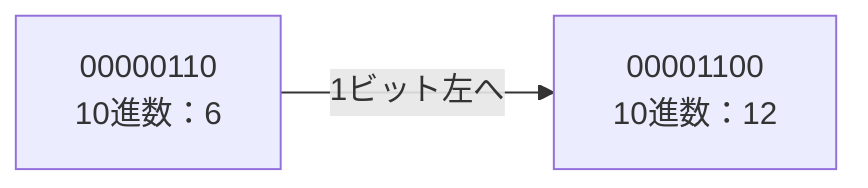
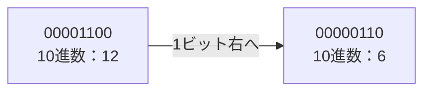
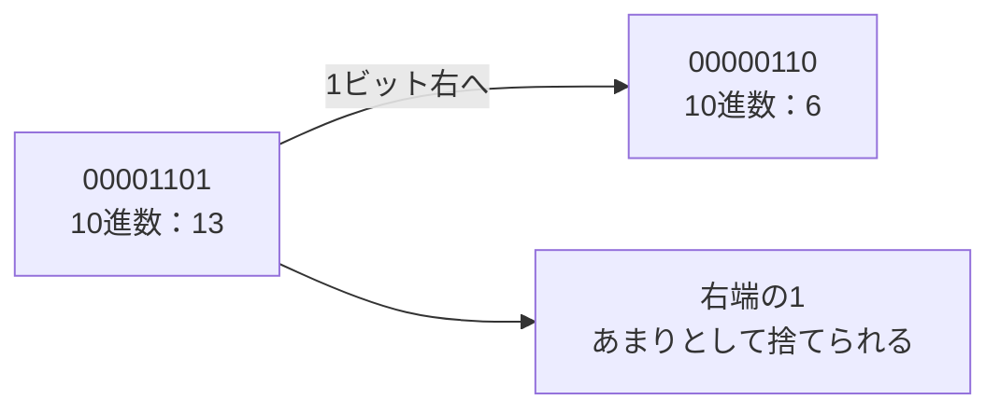
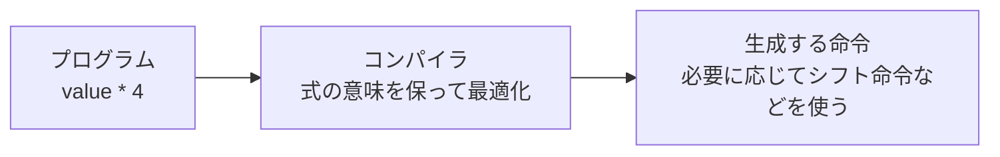
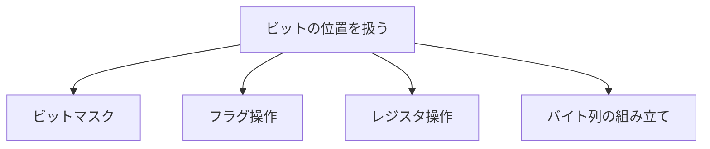

# プログラマーのための数の教養

## ～0と1から学ぶコンピュータの世界～

# 第2章 ビット演算

#7 シフト演算

## はじめに

シフト演算は、整数を2進数のビット列として考え、各ビットの位置を左または右へ移動する演算です。

C言語では、左シフトに`<<`、右シフトに`>>`を使います。

この回では、シフト演算の基本を2進数とC言語のサンプルプログラムで確認します。

---

## この章で学ぶこと

- 左シフト`<<`の基本
- 右シフト`>>`の基本
- 左へ1ビットで2倍になる理由
- 右へ1ビットで半分になる理由
- nビットの移動と2のn乗の関係
- 奇数を右シフトしたときの動作
- 数値計算とビット操作の使い分け

---

## 左シフト

6を8ビットの2進数で表すと、`00000110`です。

```text
00000110 << 1 = 00001100
```

左へ1ビット移動すると、各ビットの位の重みが2倍になります。

```text
00000110 = 4 + 2 = 6
00001100 = 8 + 4 = 12
```

そのため、6を1ビット左シフトすると12になります。

```text
6 × 2 = 12
```



ビットを左へ移動すると、それぞれの1が1つ上の位へ移ります。`4`の位は`8`の位へ、`2`の位は`4`の位へ移るため、値は6から12になります。

---

## 左へnビット移動する

```c
value << n
```

左へnビット移動すると、結果を表現できる範囲では、2のn乗を掛けた値と対応します。

| 左へ移動するビット数 | 2の累乗 | 倍率 |
|---:|---:|---:|
| 1ビット | 2¹ | 2倍 |
| 2ビット | 2² | 4倍 |
| 3ビット | 2³ | 8倍 |

```text
value << n  は value × 2ⁿ
```

ただし、左端からビットがはみ出す場合や、型で表現できる範囲を超える場合には注意が必要です。また、シフト回数は、整数に拡張された後の型のビット幅より小さい必要があります。

---

## 右シフト

12を8ビットの2進数で表すと、`00001100`です。

```text
00001100 >> 1 = 00000110
```

符号なし整数を右へ1ビット移動すると、2で割った整数部分と対応します。

```text
12 ÷ 2 = 6
```

```text
value >> n  は value ÷ 2ⁿ
```



この関係は、ここで扱っている符号なし整数についてのものです。符号付き負数の右シフトは、同じ説明だけでは扱えないため注意が必要です。

---

## 奇数を右シフトする

13を1ビット右シフトすると、結果は6になります。

```text
00001101 >> 1 = 00000110
```

右端からはみ出した1は捨てられます。

```text
13 ÷ 2 = 6 あまり 1
```

符号なし整数の右シフトでは、小数部分やあまりは結果に残りません。



---

## ソースコード

ファイル名：`07_shift/shift_basic.c`

```c
#include <stdio.h>
#include <stdint.h>

int main(void)
{
    uint8_t value = 12;

    printf("value      : %u\n", (unsigned int)value);
    printf("value << 1 : %u\n", (unsigned int)(value << 1));
    printf("value << 2 : %u\n", (unsigned int)(value << 2));
    printf("value >> 1 : %u\n", (unsigned int)(value >> 1));
    printf("value >> 2 : %u\n", (unsigned int)(value >> 2));

    return 0;
}
```

---

## コードの解説

### 符号なし8ビット整数を使う

```c
uint8_t value = 12;
```

`uint8_t`は、符号なし8ビット整数型です。このサンプルでは、12を使って左シフトと右シフトの動作を確認します。

C言語では、`uint8_t`の値にシフト演算を行う前に整数拡張が適用されます。この環境では`value`が`int`へ拡張された後にシフトされるため、`value << 1`や`value << 2`の結果を`unsigned int`へキャストして表示しています。

### 左シフトの結果を表示する

```c
printf("value << 1 : %u\n", (unsigned int)(value << 1));
printf("value << 2 : %u\n", (unsigned int)(value << 2));
```

`value << 1`は24、`value << 2`は48になります。シフト演算子は、元の`value`を書き換えません。

### 右シフトの結果を表示する

```c
printf("value >> 1 : %u\n", (unsigned int)(value >> 1));
printf("value >> 2 : %u\n", (unsigned int)(value >> 2));
```

12を1ビットと2ビット右シフトした結果を表示します。

---

## コンパイル

ターミナルで`07_shift`ディレクトリへ移動し、次のコマンドを実行します。

```bash
clang -std=c17 -Wall -Wextra -Wpedantic shift_basic.c -o shift_basic
```

---

## 実行

```bash
./shift_basic
```

実行結果：

```text
value      : 12
value << 1 : 24
value << 2 : 48
value >> 1 : 6
value >> 2 : 3
```

---

## シフト演算は高速？

2の累乗による乗算や除算を、シフト演算へ書き換える方法が使われることがあります。

```c
value * 4
value << 2
```

しかし、現在のコンパイラは、`value * 4`のように処理の意図が読み取りやすい式から、必要に応じて効率的な命令を生成します。高速化だけを目的に、乗算をシフト演算へ書き換える必要はありません。



- 数値を4倍する意図なら、`value * 4`
- ビット列を2ビット左へ動かす意図なら、`value << 2`

「どちらが速そうか」ではなく、処理の意図に合う書き方を選びます。実際に性能が問題になる場合は、推測だけで書き換えず、コンパイラが生成したコードや計測結果を確認します。

---

## シフト演算を使う場面

シフト演算は、数値の大きさだけでなく、ビットの位置そのものに意味がある処理で使います。

| 用途 | 何をするか | C言語の例 |
|---|---|---|
| ビットマスク | 1つのビットを選ぶ | `1u << bit_position` |
| フラグ操作 | 指定したフラグをONにする | `flags \|= mask` |
| レジスタ操作 | 特定のビットを取り出す | `(reg >> position) & 1u` |
| バイト列 | 複数バイトから値を作る | `(high << 8) \| low` |



- 数値を2倍するなら、`value * 2`
- ビット列を1つ左へ動かすなら、`value << 1`

同じ結果になる場合でも、数値計算とビット操作のどちらを意図しているかで、読み手に伝わりやすい書き方は変わります。

---

## まとめ

- `<<`はビットを左へ移動する
- `>>`はビットを右へ移動する
- 左へ1ビットで2倍と対応する
- 右へ1ビットで半分の整数部分と対応する
- nビットの移動は2のn乗と関係する
- 数値計算とビット操作の意図を使い分ける

---

## シリーズ一覧

- [#1 なぜプログラマーは2進数を学ぶの？](../01_binary/)
- [#2 10進数・2進数・8進数・16進数とは？](../02_number_system/)
- [#3 なぜ16進数なの？](../03_hexadecimal/)
- [#4 1バイトはなぜ256通り？](../04_byte/)
- [#5 ビット演算とは？AND・OR・XOR・NOTを0と1から理解しよう！](../05_bitwise/)
- [#6 ビット演算は何に使う？](../06_bitwise_use/)
- **#7 シフト演算**
- #8 二の補数とは？（予定）
